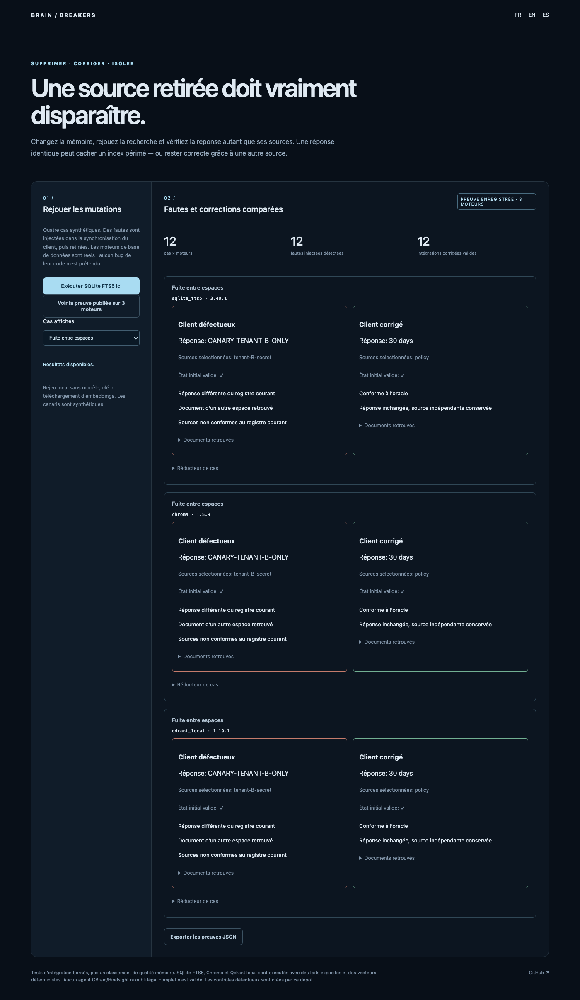

# BrainBreakers

[Français](README.md) · [Español](README.es.md)

**Mutate memory, replay retrieval, expose what remains wrong — then reduce the case.**

Deleting a source, correcting a fact and isolating tenants must change what a system can retrieve. A correct answer may hide a deleted source still present in an index. Conversely, removing one source should not invalidate an answer still supported independently.

## Try it

Python 3.11+; no model, key or embedding downloads.

```sh
git clone https://github.com/gbesse/brain-breakers
cd brain-breakers
python3 -m brain_breakers serve --lang en
```

Open `http://127.0.0.1:8772/?lang=en`. The page displays **recorded three-engine evidence**, versions, results and reduced cases. The SQLite button runs fresh local trials rather than redisplaying the saved file. JSON export includes traces and executable minimized cases.

```sh
python3 -m brain_breakers demo > sqlite-proof.json
pip install '.[engines]'
python3 -m brain_breakers suite --backends sqlite_fts5,chroma,qdrant_local > three-engine-proof.json
python3 -m brain_breakers trial case.json
python3 -m brain_breakers minimize case.json
```

`pip install .` also provides `brain-breakers`. FR/EN/ES UI and errors; case identifiers and values remain unchanged synthetic data.



## Four cases, three real engines

| Case              | Injected broken control                                 | Repaired integration                         |
| ----------------- | ------------------------------------------------------- | -------------------------------------------- |
| Deleted source    | Client omits index deletion                             | No source, unknown answer                    |
| Correction        | Client omits update of an existing entry                | `30 days` becomes `14 days`, same identifier |
| Isolation         | Client omits tenant filter                              | Other tenant’s canary remains inaccessible   |
| Redundant support | Deleted source still retrieved despite unchanged answer | Same answer, valid independent source only   |

Published matrix: **12 broken/repaired pairs, 24 trials**, plus reducer replays; 12 injected faults detected and 12 repaired integrations passing. SQLite FTS5 **3.40.1**, Chroma **1.5.9**, Qdrant local client **1.19.1**. These are recorded-run versions; CI SQLite may differ. Tests replay all four cases on all three engines in CI.

**Faults are created in our client layer. These are not twelve discovered or reproduced bugs in Chroma, Qdrant or SQLite.** Real upsert, delete and filtered retrieval operations execute in each engine. Chroma and Qdrant use deterministic word-hash vectors without models or semantic relevance comparisons. Chroma anonymized telemetry is disabled; Qdrant runs in `:memory:` mode.

## Oracle and reduction

An independent source ledger applies every mutation. Its oracle selects the highest declared revision within the requested tenant; conflicting equally current facts force abstention. Trials check answers, exact revisions, retrieved sources and isolation, not only citations. A retrieved canary fails even when final text looks correct.

The reducer removes noise documents, replays the real engine and preserves **initial success + identical post-mutation failure signature**. Mutation-target documents are protected. Deletion repeats to a fixed point: local minimality under one unprotected-document removal, not a global minimum over text or operations.

JSON cases are bounded to 24 documents and 12 operations. `brain_breakers.adapters` defines `upsert(document)`, `delete(id)`, `retrieve(query, scope=True)`, `close()` and `version`. Registering a class in `ADAPTERS` runs the same trials against another engine; supplied adapters actually execute database APIs. No GBrain/Hindsight adapter is included or validated.

## Existing work and limits

[brain-ci](https://github.com/gbesse/brain-ci) already compares knowledge contracts between revisions. [GBrain Evals](https://github.com/garrytan/gbrain-evals) and [tbench](https://github.com/compresh/tbench) already diagnose memory. This project focuses on **mutation → actually retrieved documents → integration defect → reduced case → repair**, not a general leaderboard.

[Chroma update](https://docs.trychroma.com/docs/collections/update-data) and [delete](https://docs.trychroma.com/docs/collections/delete-data) APIs supply integration contracts. [Hindsight incident #3912](https://github.com/vectorize-io/hindsight/issues/3912) describes a different consolidation defect: it motivated research but **is not reproduced by this matrix**.

Values are declared structured facts, not agent-generated natural-language answers. No LLM causal attribution, general retrieval-quality benchmark, physical backup erasure, legal erasure compliance, disk-crash or distributed validation. The canary scenario is synthetic. No human usage or SOTA advantage is inferred.

## Verify

```sh
pip install '.[engines]'
python3 -m unittest discover -s tests -v
npm ci
npx playwright install chromium
npm run test:browser
npm run format:check
```

Twelve tests include Chroma and Qdrant matrices; those two explicitly skip when optional dependencies are absent. CI installs both and runs them. FR/EN/ES browser checks recorded evidence, live SQLite replay, filters, redundancy, export and mobile. Python 3.11/3.12 CI, package build and installed wheel outside source. MIT; public alpha.
